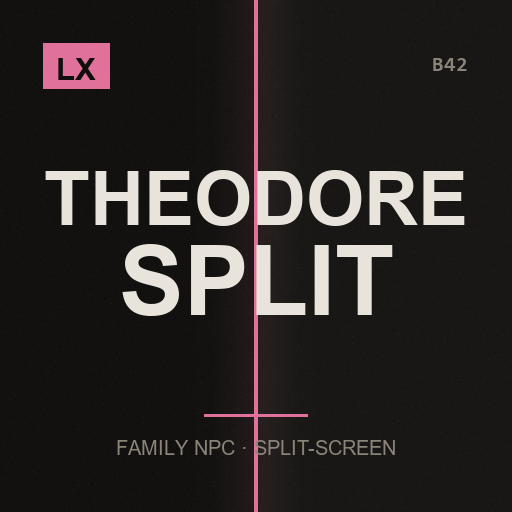

# LX Theodore Split-Screen Fix

**Your son notices every player, and works with a controller**

> Theodore is a lovely mod that says, right in its own description, single-player only. It does not have to be.

`Project Zomboid B42.21+` · `v1.1.0` · `CC0`

[English](#english) · [Español](#español) · [Русский](#русский)

---

## English

This mod is part of the **LX Split-Screen Suite**, seven mods that make Project Zomboid B42 playable in 2–4 player couch co-op, with or without a gamepad. Each one stands alone — install only what you need.

### Why split-screen?

Split-screen is the mode that carries the most bugs in stable B42 — and the mods worth playing with, like Bandits and Project A-Life, are built for singleplayer and online multiplayer. Nobody is fixing couch co-op. This suite exists to close that gap: to make split-screen as playable as the modes that get the attention.

### Why gamepad?

B42 keeps improving controller support, but it is still rough, and the aim-and-shoot rework left gunplay on a gamepad close to unusable — you cannot even shoot a zombie lying on the ground. Split-screen *with* a gamepad is the worst case the game offers. These mods give PZ back an aim that was designed for a stick: assist on the vertical axis, B41-style lock-on, per-player aim state, and a lot more.

### What it does

- **He sees every local player** — Theodore asks the game for "the player" 166 times, and outside single-player that call only ever returns one of you. Everything that is about perceiving you - distance, following, talking, reacting, looking at what you carry - now resolves to the closest living local player instead.
- **Your saves keep working** — Two things must NOT move between players: where his saved data lives, and whether he calls you Mom or Dad. Those stay anchored to player 1, exactly where the original put them, so a save from before this mod loads unchanged.
- **His menus open for whoever asked** — Theodore built his context menus for player 0, hardcoded. Player 2 could not open them at all - with a mouse or a gamepad. They now open for the player who asked, and because Project Zomboid's context menu takes that player's controller focus, this is what makes him usable on a gamepad at all.
- **His panel stays on your half of the screen, and takes a gamepad** — Theodore's panel and floating button were placed against the whole window, so in split-screen they drifted onto the other player's half. They are now kept inside the viewport of whoever is using them, dragging included. The panel also answers to a controller: d-pad walks the buttons, A presses, B closes. If that player has no gamepad assigned, nothing changes for them.
- **One son, not one per player** — Theodore stays a single character the household shares, which is how the original models him. Both of you feed him, talk to him and keep him safe; he just answers to whoever is nearby.
- **Nothing of Theodore is redistributed** — His files are read from your installed copy at load time, patched in memory and run from there. The mod always sits on top of whatever Theodore version you have, and none of his work is shipped inside this mod.

### Requirements

| Mod | Workshop | |
|---|---|---|
| Theodore | [3830500541](https://steamcommunity.com/sharedfiles/filedetails/?id=3830500541) | required |

**Load order:** load this **after** `Theodore`. `mod.info` already declares it.

### Installing

**From the Steam Workshop (recommended)**
Subscribe on the Workshop page. Steam downloads it; then start Project Zomboid, go to
**Mods** in the main menu and enable it. In split-screen, enabling it once covers all players.

**Manually**
1. Download this repository (green **Code** button -> **Download ZIP**) and unzip it.
2. Copy the folder `LX_TheodoreSplit` into your Zomboid mods folder:
   - Windows: `C:\Users\<you>\Zomboid\mods\`
   - Linux: `~/Zomboid/mods/`
   - macOS: `~/Library/Application Support/Zomboid/mods/`
   The result must be `...\Zomboid\mods\LX_TheodoreSplit\42\mod.info`.
3. Start the game, open **Mods** in the main menu and enable **LX Theodore Split-Screen Fix**.

### Notes

- **Nothing is installed inside Theodore's folder.** Each patch is matched against an exact snippet; if Theodore updates and a snippet no longer matches, that patch is skipped with a note in `console.txt` and his original code runs unchanged.
- A summary of how many changes were applied is printed in `console.txt` at game start.
- The gamepad navigation only engages for a player who actually has a controller assigned, and the panel releases that controller the moment it closes or anything goes wrong - a panel that keeps the pad would leave you unable to move, which is worse than no navigation at all. On keyboard and mouse nothing changes.
- Must load **after** Theodore. `mod.info` already declares it.
- Credit where it is due: Theodore is not mine. This only teaches it to count past one player.

### License

**CC0 1.0 Universal** — public domain dedication. Do whatever you want with it: copy it, change it, put it in a modpack, publish it, sell it. No permission needed, no credit required (though it is always welcome). See `LICENSE`.

### Support

If these mods made your co-op run work, you can buy me a coffee — 

### The rest of the suite

- [LX Coop Fixes](https://github.com/litoxperaloca/LX_CoopFixes) — Split-screen stability: vehicle crash, player 2 aiming, map stutter, error spam.
- [LX Split Aim](https://github.com/litoxperaloca/LX_SplitAim) — Controller aim assist and B41-style lock-on, per local player.
- [LX Split-Screen Quick Build](https://github.com/litoxperaloca/LX_SPLITSCREEN_CONTEXTMENU_BUILDING) — B41-style build menu in the context menu, because B42's window does not fit.
- [LX A-Life Split-Screen Fix](https://github.com/litoxperaloca/LX_ALifeSplit) — Project A-Life NPCs react to every local player, not just player 1.
- [LX Bandits Split-Screen Fix](https://github.com/litoxperaloca/LX_BanditsSplit) — Bandits target the right player, companions follow who recruited them.
- [LX Split-Screen Welcome Package](https://github.com/litoxperaloca/LX_SPLITSCREEN_WELCOME_PACKAGE) — A configurable starter kit per local character.
- [LX Split-Screen Skills Boost](https://github.com/litoxperaloca/LX_SPLITSCREEN_SKILLS_IMPROVE) — A configurable skill floor per local character.
- [LX NPC Bases Split-Screen Fix](https://github.com/litoxperaloca/LX_NPCBasesSplit) — Bandit settlements open on your half of the screen, take a gamepad, and keep appearing as you travel.

---

## Español

> Theodore es un mod hermoso que dice, en su propia descripcion, solo un jugador. No tiene por que ser asi.

Este mod es parte de la **LX Split-Screen Suite**, siete mods que hacen jugable Project Zomboid B42 en coop de sillón de 2 a 4 jugadores, con o sin mando. Cada uno funciona por separado — instalá solo lo que precises.

### ¿Por qué pantalla dividida?

Es la modalidad con más bugs en la B42 estable — y los mods que valen la pena, como Bandits y Project A-Life, están pensados para un jugador y multijugador online. Nadie arregla el coop de sillón. Esta suite existe para cerrar esa brecha: dejar la pantalla dividida a la par de las modalidades que sí reciben atención.

### ¿Por qué mando?

La B42 viene mejorando el soporte de mando, pero todavía deja mucho que desear, y el rework de apuntado y disparo dejó el tiroteo con mando casi imposible — ni siquiera podés dispararle a un zombi en el suelo. Pantalla dividida *con* mando es el peor escenario posible del juego. Estos mods le devuelven a PZ un apuntado pensado para stick: asistencia en el eje vertical, fijado de blanco estilo B41, estado de apuntado por jugador, y bastante más.

### Qué hace

- **Ve a todos los jugadores locales** — Theodore le pide al juego "el jugador" 166 veces, y fuera de un jugador esa llamada devuelve siempre a uno solo. Todo lo que tiene que ver con percibirte - distancia, seguirte, hablarte, reaccionar, mirar lo que llevas - ahora resuelve al jugador local vivo mas cercano.
- **Tus partidas siguen andando** — Hay dos cosas que NO pueden moverse entre jugadores: donde viven sus datos guardados, y si te dice Mom o Dad. Esas quedan ancladas al jugador 1, exactamente donde las puso el original, asi que una partida anterior a este mod carga sin cambios.
- **Sus menus se abren para quien los pidio** — Theodore armaba sus menus contextuales para el jugador 0, fijo en el codigo. El jugador 2 no podia abrirlos ni con mouse ni con mando. Ahora se abren para quien los pidio, y como el menu contextual de Project Zomboid toma el foco del mando de ese jugador, eso es justamente lo que lo hace usable con mando.
- **Su panel se queda en tu mitad de pantalla, y anda con mando** — El panel y el boton flotante de Theodore se ubicaban contra la ventana entera, asi que en pantalla dividida se iban a la mitad del otro jugador. Ahora se mantienen dentro del viewport de quien los esta usando, incluso al arrastrarlos. El panel ademas responde al mando: la cruceta recorre los botones, A activa, B cierra. Si ese jugador no tiene mando asignado, para el no cambia nada.
- **Un hijo, no uno por jugador** — Theodore sigue siendo un solo personaje que la casa comparte, que es como lo piensa el original. Los dos le dan de comer, le hablan y lo cuidan; el simplemente le responde a quien tenga cerca.
- **No se redistribuye nada de Theodore** — Sus archivos se leen de tu copia instalada al cargar, se parchean en memoria y se ejecutan desde ahi. El mod siempre corre sobre la version de Theodore que tengas, y no lleva adentro nada de su trabajo.

### Requisitos

| Mod | Workshop | |
|---|---|---|
| Theodore | [3830500541](https://steamcommunity.com/sharedfiles/filedetails/?id=3830500541) | obligatorio |

**Orden de carga:** cargá este **después** de `Theodore`. El `mod.info` ya lo declara.

### Instalación

**Desde el Steam Workshop (recomendado)**
Suscribite en la página del Workshop. Steam lo descarga solo; después abrí Project Zomboid,
andá a **Mods** en el menú principal y activalo. En pantalla dividida, con activarlo una vez
alcanza para todos los jugadores.

**A mano**
1. Descargá este repositorio (botón verde **Code** -> **Download ZIP**) y descomprimilo.
2. Copiá la carpeta `LX_TheodoreSplit` a tu carpeta de mods de Zomboid:
   - Windows: `C:\Users\<vos>\Zomboid\mods\`
   - Linux: `~/Zomboid/mods/`
   - macOS: `~/Library/Application Support/Zomboid/mods/`
   Tiene que quedar `...\Zomboid\mods\LX_TheodoreSplit\42\mod.info`.
3. Abrí el juego, entrá a **Mods** en el menú principal y activá **LX Theodore Split-Screen Fix**.

### Notas

- **No se instala nada dentro de la carpeta de Theodore.** Cada parche se compara contra un fragmento exacto; si Theodore se actualiza y un fragmento deja de coincidir, ese parche se omite con un aviso en `console.txt` y su codigo original corre sin cambios.
- Al iniciar la partida se imprime en `console.txt` un resumen de cuantos cambios se aplicaron.
- La navegacion con mando solo se activa para un jugador que realmente tenga un control asignado, y el panel suelta ese control apenas se cierra o si algo falla: un panel que se queda con el mando te deja sin poder moverte, que es peor que no tener navegacion. Con teclado y mouse no cambia nada.
- Debe cargar **despues** de Theodore. El `mod.info` ya lo declara.
- El credito donde corresponde: Theodore no es mio. Esto solo le ensena a contar mas alla de un jugador.

### Licencia

**CC0 1.0 Universal** — dedicado al dominio público. Hacé lo que quieras: copialo, cambialo, metélo en un modpack, publicalo, vendelo. No hace falta permiso ni crédito (aunque siempre se agradece). Ver `LICENSE`.

### Apoyar

Si estos mods te arreglaron el coop, podés invitarme un café — 

### El resto de la suite

- [LX Coop Fixes](https://github.com/litoxperaloca/LX_CoopFixes) — Estabilidad en pantalla dividida: crash de vehículos, apuntado del jugador 2, tirones del mapa, spam de errores.
- [LX Split Aim](https://github.com/litoxperaloca/LX_SplitAim) — Asistencia de apuntado con mando y fijado de blanco estilo B41, por jugador local.
- [LX Split-Screen Quick Build](https://github.com/litoxperaloca/LX_SPLITSCREEN_CONTEXTMENU_BUILDING) — Menú de construcción estilo B41 en el menú contextual, porque la ventana de B42 no entra.
- [LX A-Life Split-Screen Fix](https://github.com/litoxperaloca/LX_ALifeSplit) — Los NPCs de Project A-Life reaccionan a todos los jugadores locales, no solo al 1.
- [LX Bandits Split-Screen Fix](https://github.com/litoxperaloca/LX_BanditsSplit) — Los bandidos apuntan al jugador correcto, los compañeros siguen a quien los reclutó.
- [LX Split-Screen Welcome Package](https://github.com/litoxperaloca/LX_SPLITSCREEN_WELCOME_PACKAGE) — Un equipo inicial configurable por personaje local.
- [LX Split-Screen Skills Boost](https://github.com/litoxperaloca/LX_SPLITSCREEN_SKILLS_IMPROVE) — Un piso de habilidades configurable por personaje local.
- [LX NPC Bases Split-Screen Fix](https://github.com/litoxperaloca/LX_NPCBasesSplit) — Los asentamientos de bandidos se abren en tu mitad de pantalla, andan con mando, y siguen apareciendo mientras viajas.

---

## Русский

> Theodore — прекрасный мод, в описании которого сказано: только один игрок. Так быть не обязано.

Этот мод входит в набор **LX Split-Screen Suite** — семь модов, которые делают Project Zomboid B42 играбельным в совместной игре на диване для 2–4 человек, с геймпадом или без. Каждый работает сам по себе — ставьте только нужное.

### Почему разделённый экран?

Разделённый экран — режим с наибольшим числом ошибок в стабильной B42, а моды, ради которых стоит играть, вроде Bandits и Project A-Life, сделаны под одиночную игру и сетевой мультиплеер. Совместной игрой на диване не занимается никто. Этот набор существует, чтобы закрыть пробел: сделать разделённый экран таким же играбельным, как режимы, которым достаётся внимание.

### Почему геймпад?

B42 продолжает улучшать поддержку контроллеров, но она всё ещё сырая, а переработка прицеливания и стрельбы сделала перестрелки с геймпада почти невозможными — вы даже не можете выстрелить в зомби, лежащего на полу. Разделённый экран *вместе* с геймпадом — худший случай, который предлагает игра. Эти моды возвращают PZ прицеливание, рассчитанное на стик: помощь по вертикальной оси, захват цели в стиле B41, отдельное состояние прицеливания для каждого игрока и многое другое.

### Что делает

- **Он видит всех локальных игроков** — Theodore 166 раз спрашивает у игры «игрока», и вне одиночной игры этот вызов всегда возвращает одного. Всё, что связано с восприятием — расстояние, слежка, разговоры, реакции — теперь указывает на ближайшего живого локального игрока.
- **Старые сохранения работают** — Две вещи НЕ должны переходить между игроками: где хранятся его данные и как он к вам обращается. Они привязаны к первому игроку, ровно туда, куда их поместил оригинал.
- **Меню открываются для того, кто их вызвал** — Контекстные меню Theodore были жёстко заданы для игрока 0, и второй игрок не мог их открыть ни мышью, ни геймпадом. Теперь меню берёт фокус геймпада нужного игрока — именно это делает мод играбельным с контроллером.
- **Панель остаётся на вашей половине экрана и работает с геймпадом** — Панель и плавающая кнопка размещались относительно всего окна и на разделённом экране уезжали на половину другого игрока. Теперь они удерживаются в пределах его области, включая перетаскивание. Панель также отвечает на геймпад: крестовина перемещается по кнопкам, A нажимает, B закрывает.
- **Один сын, а не по одному на игрока** — Theodore остаётся одним персонажем на всю семью, как и задумано в оригинале. Он просто отвечает тому, кто рядом.
- **Ничего из Theodore не распространяется** — Его файлы читаются из вашей копии при загрузке, патчатся в памяти и запускаются оттуда.

### Требования

| Mod | Workshop | |
|---|---|---|
| Theodore | [3830500541](https://steamcommunity.com/sharedfiles/filedetails/?id=3830500541) | обязательно |

**Порядок загрузки:** загружайте этот мод **после** `Theodore`. `mod.info` уже это объявляет.

### Установка

**Из Steam Workshop (рекомендуется)**
Подпишитесь на странице Workshop. Steam скачает мод сам; затем запустите Project Zomboid,
откройте **Моды** в главном меню и включите его. При разделённом экране достаточно включить
один раз — это работает для всех игроков.

**Вручную**
1. Скачайте этот репозиторий (зелёная кнопка **Code** -> **Download ZIP**) и распакуйте.
2. Скопируйте папку `LX_TheodoreSplit` в папку модов Zomboid:
   - Windows: `C:\Users\<вы>\Zomboid\mods\`
   - Linux: `~/Zomboid/mods/`
   - macOS: `~/Library/Application Support/Zomboid/mods/`
   Должно получиться `...\Zomboid\mods\LX_TheodoreSplit\42\mod.info`.
3. Запустите игру, откройте **Моды** в главном меню и включите **LX Theodore Split-Screen Fix**.

### Примечания

- **Внутрь папки Theodore ничего не устанавливается.** Если мод обновится и фрагмент перестанет совпадать, этот патч пропускается.
- При запуске игры в `console.txt` выводится сводка применённых изменений.
- Навигация геймпадом включается только для игрока с назначенным контроллером, и панель отпускает его сразу при закрытии или при любой ошибке: панель, удерживающая геймпад, оставит вас без управления. С клавиатурой и мышью ничего не меняется.
- Загружать **после** Theodore.
- Theodore — не мой мод. Этот патч лишь учит его считать дальше одного игрока.

### Лицензия

**CC0 1.0 Universal** — передано в общественное достояние. Делайте что угодно: копируйте, изменяйте, включайте в сборки модов, публикуйте, продавайте. Разрешение не требуется, указание авторства не обязательно (но всегда приятно). См. `LICENSE`.

### Поддержать

Если эти моды помогли вашей совместной игре, можете угостить меня кофе — 

### Остальные моды набора

- [LX Coop Fixes](https://github.com/litoxperaloca/LX_CoopFixes) — Стабильность разделённого экрана: вылет транспорта, прицеливание второго игрока, подтормаживания карты.
- [LX Split Aim](https://github.com/litoxperaloca/LX_SplitAim) — Помощь прицеливания с геймпада и захват цели в стиле B41 для каждого локального игрока.
- [LX Split-Screen Quick Build](https://github.com/litoxperaloca/LX_SPLITSCREEN_CONTEXTMENU_BUILDING) — Меню строительства в стиле B41 в контекстном меню, потому что окно B42 не помещается.
- [LX A-Life Split-Screen Fix](https://github.com/litoxperaloca/LX_ALifeSplit) — NPC из Project A-Life реагируют на всех локальных игроков, а не только на первого.
- [LX Bandits Split-Screen Fix](https://github.com/litoxperaloca/LX_BanditsSplit) — Бандиты целятся в нужного игрока, напарники следуют за тем, кто их нанял.
- [LX Split-Screen Welcome Package](https://github.com/litoxperaloca/LX_SPLITSCREEN_WELCOME_PACKAGE) — Настраиваемый стартовый набор для каждого локального персонажа.
- [LX Split-Screen Skills Boost](https://github.com/litoxperaloca/LX_SPLITSCREEN_SKILLS_IMPROVE) — Настраиваемый минимальный уровень навыков для каждого локального персонажа.
- [LX NPC Bases Split-Screen Fix](https://github.com/litoxperaloca/LX_NPCBasesSplit) — Поселения бандитов открываются на вашей половине экрана, работают с геймпадом и продолжают появляться по мере путешествия.

